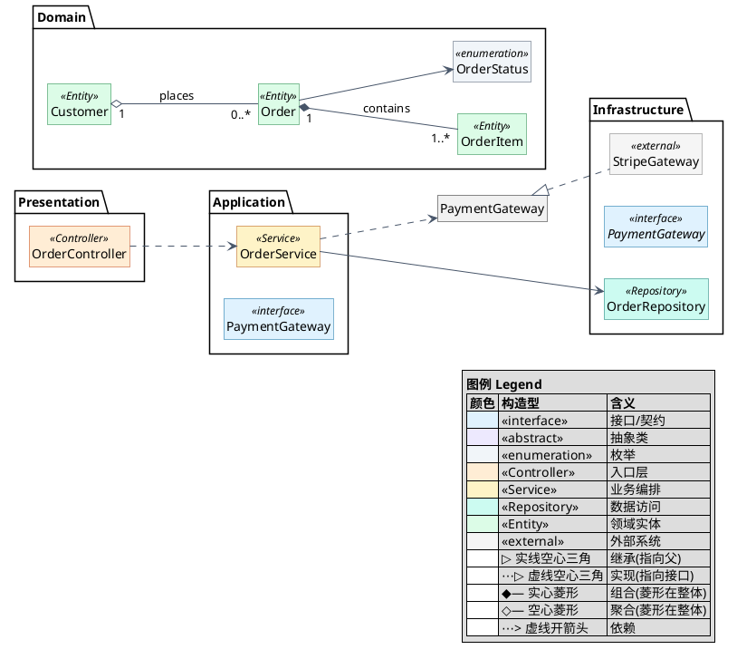
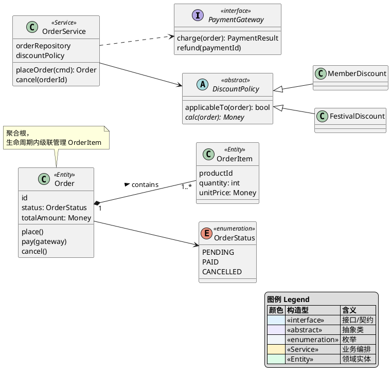
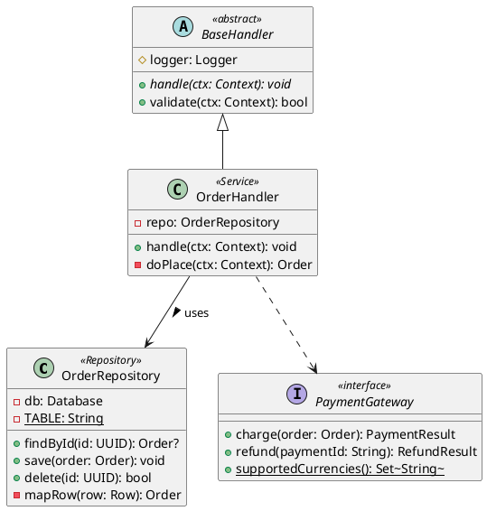
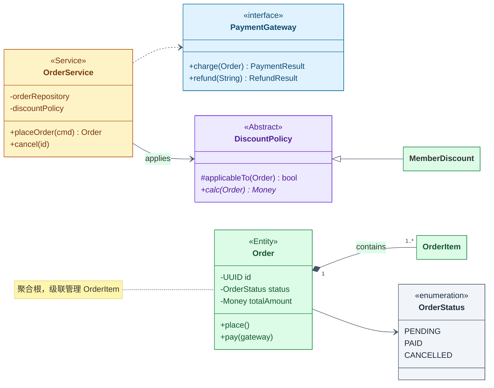

# 类图模板（L1 / L2 / L3 + Mermaid 降级）

规则：**复制整个模板 → 只替换"CONTENT AREA"区 → 主题区（THEME BLOCK）一字不改**。
每张图自包含（主题内联），本地 plantuml.jar 与 Kroki 在线渲染均可直接使用。

主题色板（低饱和、黑白可辨、按构造型分组）：

| 构造型 | 填充 | 边框 |
|---|---|---|
| `<<interface>>` | `#E0F2FE` | `#0369A1` |
| `<<abstract>>` | `#EDE9FE` | `#6D28D9` |
| `<<enumeration>>` | `#F1F5F9` | `#475569` |
| `<<Controller>>` | `#FFEDD5` | `#C2410C` |
| `<<Service>>` | `#FEF3C7` | `#B45309` |
| `<<Repository>>` | `#CCFBF1` | `#0F766E` |
| `<<Entity>>` | `#DCFCE7` | `#15803D` |
| `<<external>>` | `#F5F5F5` | `#737373`（虚线边框） |

---

## 模板 L1 —— 概览级（仅类名 + 关系）

---

## 模板 L2 —— 结构级（默认：关键成员，无可见性符号）

主题块与 L1 完全相同（复制 L1 的 THEME BLOCK），下面只示意内容区写法：

L2 成员纪律：每类 ≤5 属性 + ≤5 方法；不带可见性符号；类型只在有信息量时写；剔除 getter/setter。

---

## 模板 L3 —— 设计级（完整签名 + 修饰符）

主题块同 L1。内容区差异示例：

L3 纪律：可见性必标；static/abstract 修饰必标；泛型用 `~T~`；成员排序 = static 在前、可见性降序；私有工具方法只在有架构意义时保留。

---

## 模板 Mermaid —— L2 降级版（同色板）

Mermaid 纪律：注解放成员块首行；`*` abstract、`$` static 后缀；多重性带引号；`note for X` 一类一条；分色用逐类 `style`（色值与 PlantUML 主题一致）；回复中提示读者：Mermaid 无布局干预能力，类多时接受自动布局或改用 PlantUML 版。

---

## 使用检查

替换内容后快速核对：

1. THEME BLOCK 未被改动；
2. 每个类带构造型（否则无色）；
3. legend 行与图中实际出现的构造型一一对应；
4. 多重性带引号、关系箭头方向符合判定表；
5. 文件名 = `@startuml` 后的名字，输出前用 `scripts/render.py` 渲染验证。
