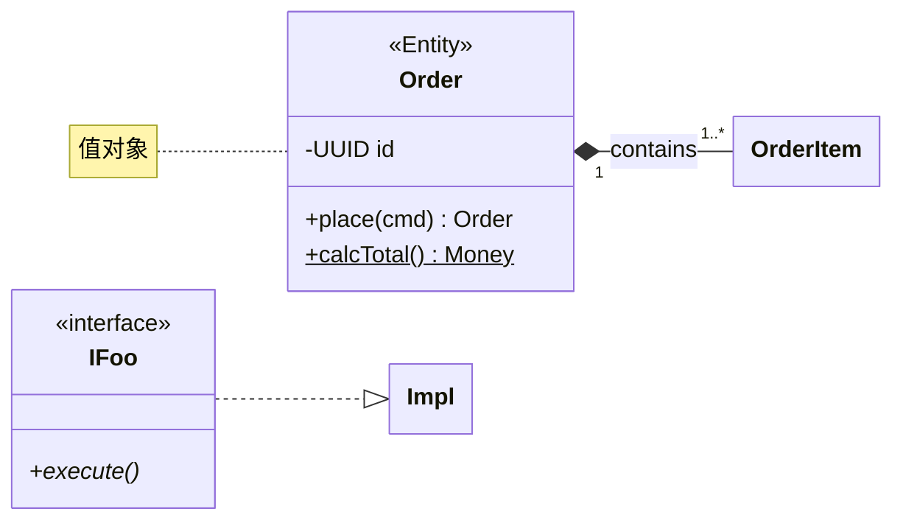

# PlantUML / Mermaid 类图语法对照（写源码时必读）

PlantUML 为主输出（表示法全、样式可控）；Mermaid 为降级输出（Markdown 原生渲染场景）。

## 1. PlantUML 类图语法要点

### 声明

```plantuml
class Foo
abstract class BaseFoo
interface IFoo
enum Status { PENDING PAID CANCELLED }
protocol P          " Swift/Dart 风格协议
```

### 成员

```plantuml
class Order {
  - id: UUID                ' 可见性 + 名字: 类型
  + items: List<OrderItem>
  {static} count: int       ' static
  {abstract} execute()      ' abstract 成员
  + place(cmd): Order
  .. 业务方法 ..            ' 分组分隔符（-- .. == 均可，可带标题）
}
```

- 修饰符 `{static}` / `{abstract}` 放行首或行尾均可；
- **渲染行为**：`{abstract}` 成员渲染为**斜体**、`{static}` 渲染为**下划线**，文字标记本身不显示——这正是 UML 标准记法，不是丢字；`abstract class` 的类名自动斜体；无成员的类在 `hide empty members` 下自动省略空栏（消灭光杆两栏）；
- 可见性 `- # ~ +`，配合 `skinparam classAttributeIconSize 0` 显示为文本符号。

### 关系（两端可带多重性与标签）

```plantuml
Parent <|-- Child                       ' 泛化
IFoo <|.. Impl                          ' 实现
Whole "1" *-- "1..*" Part : contains >  ' 组合 + 多重性 + 动词条 + 阅读方向
Team "1" o-- "0..*" Member              ' 聚合
User --> Role : assigned                 ' 关联
Service ..> Clock                       ' 依赖
Foo -left-> Bar                         ' 强制方向（left/right/up/down）
Foo -[hidden]-> Bar                     ' 隐藏线：只影响布局
```

### 隐藏与成员控制

```plantuml
hide empty members      ' 空成员栏省略（主题已含）
hide private members    ' 进一步按可见性裁剪
hide @unlinked          ' 不画孤立类
```

### 包与注释

```plantuml
package "domain" { ... }
note top of Order : 值对象，不可变       ' 说明类的作用（中文 OK）
note on link : 级联删除                  ' 说明关系语义
```

### 布局

```plantuml
left to right direction   ' 继承树/分层横向；默认自上而下
together { A B }           ' 聚拢高内聚类
skinparam groupInheritance 2 ' 同父多子合并连线为树
```

## 2. 主题参数解释（assets 模板中 `theme` 块的含义）

| 参数 | 作用 | 为什么固定 |
|---|---|---|
| `skinparam shadowing false` | 去阴影 | 扁平、印刷友好 |
| `skinparam classAttributeIconSize 0` | 可见性用文本符号 | 图标形状非 UML 标准形，文本 `+ - # ~` 更规范 |
| `skinparam class { ... }` 按构造型着色 | 分组视觉语义 | 颜色 = 角色分组，配合图例 |
| `skinparam ArrowColor / ArrowThickness` | 统一线色线宽 | 视觉一致 |
| `skinparam roundCorner 0` | 直角矩形 | 标准 UML 类框为直角 |
| `skinparam LegendBackgroundColor` | 图例底色 | 与背景协调 |
| `hide empty members` | 空栏省略 | 消灭"光杆两栏" |
| `skinparam groupInheritance 2` | 继承合并 | ≥2 子类即合树，减少连线 |

**不要**在图内容里另加 `skinparam` 或内联 `#color`——颜色只由构造型分组决定，保证每张图风格一致。

## 3. Mermaid classDiagram 语法要点



- 可见性 `+ - # ~`；返回类型写在方法后（空格分隔）；
- 分类符后缀：`$` static、`*` abstract；
- 泛型用波浪：`List~int~`；
- 注解三选一：`<<interface>>` / `<<Abstract>>` / `<<enumeration>>`，可放成员块首行；
- 关系：`<\|` 继承、`*--` 组合、`o--` 聚合、`-->` 关联、`..>` 依赖、`..|>` 实现；
- 多重性带引号放箭头两侧：`A "1" --> "0..*" B`；
- `namespace X { }` 表达包。

**分色必须用逐类 `style` 语句**（实测结论，2026-11 验证于 Kroki）：

```
style OrderService fill:#FEF3C7,stroke:#B45309,color:#78350F
```

`classDef` + `class X:::样式名` 与 `cssClass` 在 Kroki 渲染管线中**不生成 CSS、不生效**（节点带上 class 名但无规则），不要使用。`style` 语句会内联到形状上，稳定生效。

**渲染与查看注意事项**：Mermaid 的 SVG 把文本放在 `<foreignObject>`（HTML）里——LibreOffice/部分转换器会把文本丢弃成空白，**目检或交付时用浏览器打开**；GitHub/VS Code 渲染正常。PlantUML 的 SVG 无此问题。

## 4. 降级补偿表（PlantUML → Mermaid）

| PlantUML 能力 | Mermaid 补偿 |
|---|---|
| abstract 类名斜体 | `<<Abstract>>` 注解块首行 |
| `{abstract}` / `{static}` 成员修饰 | `*` / `$` 后缀 |
| 构造型任意（Service/Repository…） | 同名注解 `<<Service>>` + 逐类 `style` 上色 |
| `note top of X` 任意位置 | `note for X "..."`（一个类一条） |
| `note on link` | 放关联 label 或类 note |
| `together` / hidden link 布局 | 不支持——靠 `direction` 与声明顺序，接受自动布局 |
| `groupInheritance` 树状合并 | 不支持——接受多连线 |
| 包 package 样式化 | `namespace`（样式有限） |
| 主题/字体精细控制 | `classDef` 只能改填充/描边/字重 |

Mermaid 输出必须：`direction LR`（或 TB 与层次一致）、`hideEmptyMembersBox: true`、`classDef` 使用与 PlantUML 主题**同一组色值**（从 assets/templates.md 的 Mermaid 模板复制）、每个构造型注解齐全。

## 5. 能力对照速览

| 能力 | PlantUML | Mermaid |
|---|---|---|
| 关联类 / 限定关联 | 有 | 无 |
| lollipop 接口 | 有 | 有限（不可共享） |
| 成员分组分隔线 | 有 | 无 |
| 布局干预 | 方向/together/hidden | 仅 direction |
| 样式 | skinparam/style 全面 | classDef 基础 |
| GitHub/MD 渲染 | 需插件 | 原生 |
